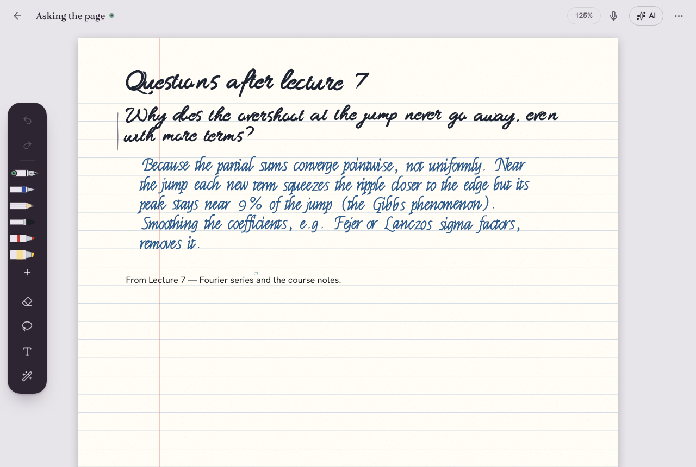
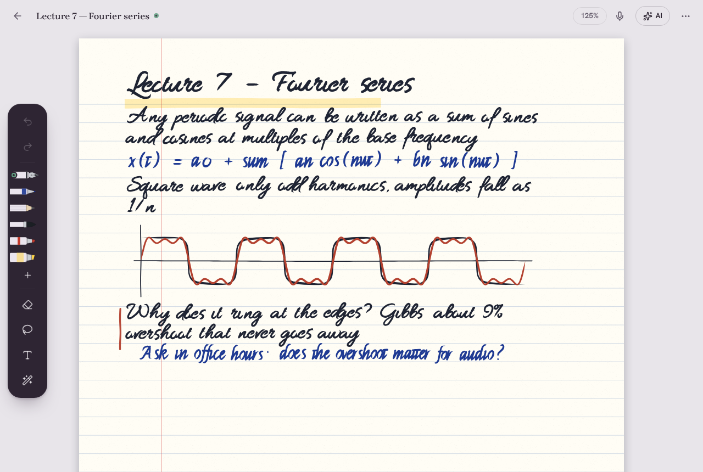
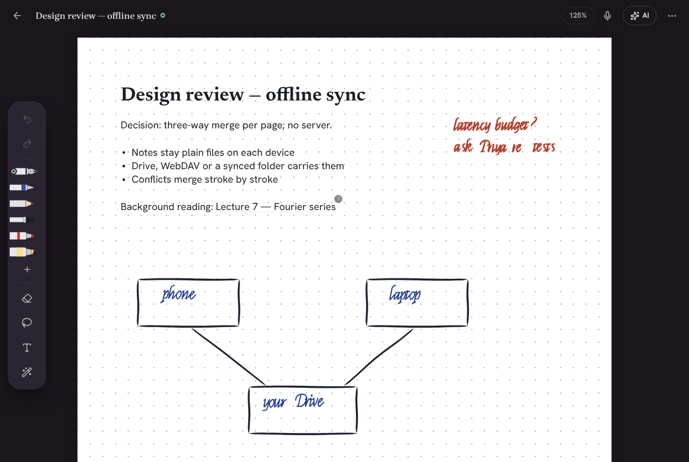

<div align="center">

<picture>
  <source media="(prefers-color-scheme: dark)" srcset="docs/media/hero-dark.svg">
  
</picture>

**A handwriting notebook that feels like paper, thinks with any AI, and answers you in ink.**<br>
Local-first. Bring your own model, or none. Open source. No server of ours, anywhere.

[Open the app](https://dev-null-k2.github.io/inkwright/app/) ·
[Download for Android](https://github.com/dev-null-k2/inkwright/releases/latest) ·
[Docs](docs/ARCHITECTURE.md) ·
[API](docs/API.md) ·
[中文](docs/i18n/README.zh-CN.md) · [日本語](docs/i18n/README.ja.md) · [Español](docs/i18n/README.es.md)

[](https://github.com/dev-null-k2/inkwright/actions/workflows/ci.yml)
[](LICENSE)




</div>

<picture><source media="(prefers-color-scheme: dark)" srcset="docs/media/section-why-dark.svg"></picture>

Paper is still the best thinking tool we have. Notes apps either feel like paper and know nothing, or know everything and feel like a form. And the AI-in-a-sidebar pattern sends your notebook to someone else's server just to answer a question about it.

Inkwright starts from the pen. Ink appears under the nib before the next frame. Scribbling a word out erases it. The nib makes a soft sound on paper and you feel the paper's grain. Then it gives that page a mind: an agent that can read your handwriting, connect it to everything else you've written, check it against itself, and write back on the page in its own visibly different ink. Your notes stay as plain files on your own devices and your own storage. Everything AI does is shown, cited, and can be undone.

It was built for a foldable phone with a stylus (Razr Fold + Moto Pen Ultra), and it works just as well on an iPad, a Windows tablet or a laptop with a mouse.

<picture><source media="(prefers-color-scheme: dark)" srcset="docs/media/section-features-dark.svg"></picture>

<table>
<tr><td width="50%" valign="top">

### ✒️ Write
- **Ink that keeps up.** Strokes are drawn from raw pen events with prediction. On Android a native ink tip draws the newest milliseconds straight to the screen.
- **Paper you can feel.** Synthesised nib-on-paper sound that follows speed and pressure. Haptic grain on Android. Three paper surfaces and nine tints.
- **Erase like paper.** Scribble over a word to delete it: it catches 99.6 % of scribbles and never erased a neighbouring word in 580 test cases. The pen button switches to the eraser.
- **Pens and tools.** Fountain, calligraphy nib, pencil, brush, highlighter, tape, sticky notes, layers, two-page spreads, snapping, locked and encrypted notes.
- **Every page you need.** Ruled, dot, Cornell, music and planner paper. Any PDF becomes pages you can write on, fill in and sign.

</td><td width="50%" valign="top">

### 🧠 Think
- **Any AI, or none.** OpenAI, Claude, Gemini, OpenRouter, Groq, Mistral, DeepSeek, Ollama, LM Studio or any compatible server. Or **on-device models** that use your phone's or laptop's GPU, with nothing sent anywhere.
- **Answers in ink.** Lasso a question and the answer is written beside it in handwriting, in a colour that is never mistaken for yours.
- **Smart ink.** Draw a grid to get a table. Circle an equation to solve it, and get a live graph. Circle a date to make a calendar event.
- **Sketch it, run it.** Draw boxes and arrows and press Run. Each box becomes a step: fetch, filter, sum, chart, or "ask the AI".
- **Notes that listen.** Lectures are transcribed on the device. Tap any ink to hear what was said while you wrote it.

</td></tr>
<tr><td valign="top">

### 🕸️ Remember
- **A wiki that writes itself.** Your notes are compiled into linked pages. Every sentence is tagged *extracted*, *inferred* or *ambiguous* and cites the exact spot on the page it came from. **Explain this answer** shows where any AI sentence came from.
- **A linter for your thinking.** It flags notes that contradict each other, such as "latency under 50 ms" on Tuesday and "averages 110 ms" on Friday.
- **Study.** FSRS flashcards from any note or lasso. A "teach it back" tutor quizzes you and finds the gaps.
- **Links, backlinks, daily notes, a 3D graph** and two-way Obsidian import and export.
- **Search everything:** handwriting, typed text, PDFs, transcripts and meaning, on the device.

</td><td valign="top">

### 🛡️ Trust
- **Every AI call passes one checkpoint.** It routes by policy, redacts personal data (and puts it back in the answer), shortens large context so you spend about 80 % fewer tokens, and meters the cost in dollars.
- **Signed audit trail** of everything AI saw and did, which you can verify offline.
- **Per-notebook permissions:** hidden, read-only, or "never leaves this device".
- **Dry run:** agents propose changes, you approve them as a diff, and every change can be undone.
- **Proof of authorship:** a signed certificate that you wrote it by hand.
- **Air-gapped appliance** (Docker, no egress) for teams.

</td></tr>
<tr><td valign="top">

### 🧩 Make it yours
- **Every feature is a module.** Switch any of them off, or start from a preset: Student, Writer, Developer, Researcher, Enterprise, Minimal.
- **Sandboxed plugins** that ask for permission first, with a [plugin API](docs/PLUGINS.md) and a starter kit.
- **Four palettes, day and night.** Duan, Aizome, Celadon and Sumi, after the inkstones and dyes of East Asian calligraphy.

</td><td valign="top">

### 🧑‍💻 For developers
- **Notes that know your code.** `[[code:src/api.ts#createOrder]]` links a note to a function, and the note is flagged when that function's signature drifts.
- **Verified diagrams.** A typed IR and a validator mean the AI has to fix its diagram before it lands on the page.
- **Runbooks** with runnable `http`, `sql` and `js` blocks, plus an incident RCA template.
- **Data sandbox.** Drop in a CSV or Excel file and query it with DuckDB in the browser.
- **Session lessons.** Claude Code and Codex transcripts become notes, and their lessons go into `AGENTS.md`.

</td></tr>
</table>

<p align="center"> </p>

<picture><source media="(prefers-color-scheme: dark)" srcset="docs/media/section-agents-dark.svg"></picture>

Your notebook is also a server that your other tools can talk to. It speaks the protocols agents already use:

| | |
|---|---|
| **MCP** (spec 2026-07-28) | stdio and Streamable HTTP; OAuth resource server; Tasks; MCP Apps; context packs as resources ([AGENTS.md](docs/AGENTS.md)) |
| **A2A** | an agent card and skills, so other agents can delegate to your notebook |
| **REST** | `/api/v1` with OpenAPI 3.1, scoped API keys, ETags, idempotency keys, rate limits ([API.md](docs/API.md)) |
| **Webhooks** | Standard Webhooks: signed and retried. `note.created`, `recording.ended`, `routine.finished`… |
| **SDK** | `@inkwright/sdk`, generated from the OpenAPI document |
| **CLI and skill** | `inkwright scan <repo>`, `inkwright drift --check` for CI, and an Agent Skill for Claude Code and Codex |
| **Links** | `inkwright://new`, `capture`, `search`, `today` for Shortcuts, Tasker and launchers |

```sh
# Give Claude Code your notebook (read-only shown; drop --read-only to let it write, with approvals)
claude mcp add --scope user inkwright -- node ./apps/mcp-server/dist/index.js --vault ~/Notes --read-only

# Or call the REST API like any other service
curl -H "Authorization: Bearer $INKWRIGHT_KEY" "http://127.0.0.1:8765/api/v1/search?q=latency&mode=hybrid"
```

## Measured, not claimed

Every number below comes from an eval or test in this repository and can be re-run with one command ([TESTING.md](docs/TESTING.md)). Where a number is weak, it is still listed.

| What | Result | How |
|---|---|---|
| Scribble-to-erase | 99.6 % of 250 scribbles caught; 0 of 330 normal strokes erased | `packages/core/evals/scratch.eval.ts` |
| Scribble-to-erase on real letter shapes (large, slanted, cursive; zig-zags, loops, strike-throughs) | 98.3 % of 300 crossed-out words fully erased; 0 neighbours touched; 0 of 200 next words or underlines erased (was 77.7 %, found after testing on a phone) | `packages/core/evals/scratch-real.eval.ts` |
| Contradiction linter | precision 1.00, recall 0.92 on 58 labelled pairs; 0 false alarms in 40 everyday notes | `packages/core/evals/compiler.eval.ts` |
| Wiki drafts vs a noisy model | provenance precision 0.92; unsupported sentences let through 0.17 | `packages/ai/evals/compiler.eval.ts` |
| Personal-data firewall | precision 100 %, recall 98.2 % (78 labelled lines; names without context are missed) | `packages/ai/evals/trust.eval.ts` |
| Context budgeter | 80 % of tokens saved across tasks; answers unchanged. "Summarise everything" costs 47 % *more* | same |
| Prompt-injection detector | **weak on held-out attacks: 29 % detected, 17 % false alarms.** What holds regardless: deletes always ask, dry run and strict mode block writes, local-only notes never reach the cloud | same |
| Sketch → graph extraction | 1.0 on 120 synthetic sketches (real sketches will do worse; you confirm the graph before it runs) | `packages/core/evals/canvasdag.eval.ts` |
| Photo → ink | traced strokes within one pen width of the source for tilted, blurred and noisy photos | `packages/core/test/photoink.test.ts` |
| Tests | 1,300+ unit tests and evals, 140+ end-to-end tests on Chromium, WebKit (Safari) and Firefox at phone, foldable and desktop sizes, 150+ Android JVM tests, zero serious accessibility violations (axe) | `npm test`, `npm run e2e:all` |

<picture><source media="(prefers-color-scheme: dark)" srcset="docs/media/section-start-dark.svg"></picture>

- **In a browser:** [open the app](https://dev-null-k2.github.io/inkwright/app/). It installs as an offline app on Mac, Windows, Linux, ChromeOS and iPad. Your notes stay in the browser until you connect Google Drive, WebDAV or a folder.
- **Android:** download the APK from [Releases](https://github.com/dev-null-k2/inkwright/releases/latest). Google Play is coming.
- **From source:**

```sh
git clone https://github.com/dev-null-k2/inkwright && cd inkwright
npm install
npm run dev        # http://localhost:5173
npm test           # unit tests and evals
npm run e2e        # end-to-end, Chromium (npm run e2e:all for WebKit and Firefox too)
```

Android: [docs/ANDROID.md](docs/ANDROID.md). Enterprise appliance: [docs/ENTERPRISE.md](docs/ENTERPRISE.md). Hosting it yourself (static files, no backend): [docs/HOSTING.md](docs/HOSTING.md).

<picture><source media="(prefers-color-scheme: dark)" srcset="docs/media/section-under-dark.svg"></picture>


| Package | What's in it |
|---|---|
| `packages/core` | data model, vault format, gestures, shapes, handwriting synthesis, search, compiler, code graph, exporters. No platform code. |
| `packages/ai` | providers, the agent loop, tools, skills, memory, routines, MCP client, the trust guard, evals |
| `packages/sync` | storage backends and the three-way, stroke-level merge |
| `packages/plugin-api`, `packages/sdk` | plugin protocol and types; the REST client |
| `apps/web` | the app (React + a canvas ink engine), a PWA, Capacitor for Android and iOS |
| `apps/mcp-server` | MCP, A2A, REST, webhooks, the always-on agent runner and the CLI |

The vault is documented field by field in [VAULT_FORMAT.md](docs/VAULT_FORMAT.md). If Inkwright disappeared tomorrow, your notes would still be readable files.

<picture><source media="(prefers-color-scheme: dark)" srcset="docs/media/section-roadmap-dark.svg"></picture>

See [ROADMAP.md](ROADMAP.md). Next up: the iOS App Store build, Google Play, live collaboration out of beta, a desktop shell with a local model runner, and real-device evals for pen latency on as many styluses as people will lend us.

<picture><source media="(prefers-color-scheme: dark)" srcset="docs/media/section-story-dark.svg"></picture>

An *inkwright* is someone who makes ink. The name fits a tool that makes ink do more: it turns strokes into meaning, and meaning back into strokes. The headings in this README were written by the app's own pen (`packages/core/src/handwrite.ts`, using single-line fonts under the OFL) and replay in the timing the synthesiser produced. Run `npm run art` to regenerate them.

Inkwright is built by [Karthik Kasukurti](https://github.com/dev-null-k2). Contributions are welcome. Start with [CONTRIBUTING.md](CONTRIBUTING.md). Security reports go through [SECURITY.md](SECURITY.md).

Licensed under [Apache-2.0](LICENSE). Fonts and third-party notices are listed in [NOTICE](NOTICE).
