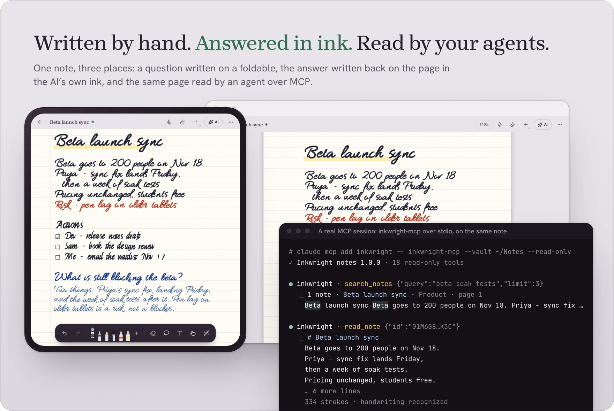
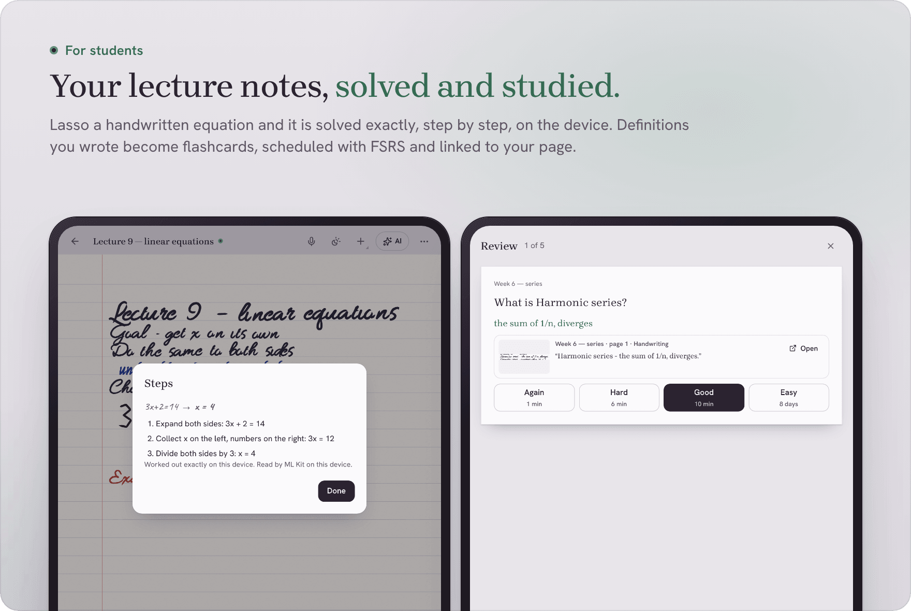
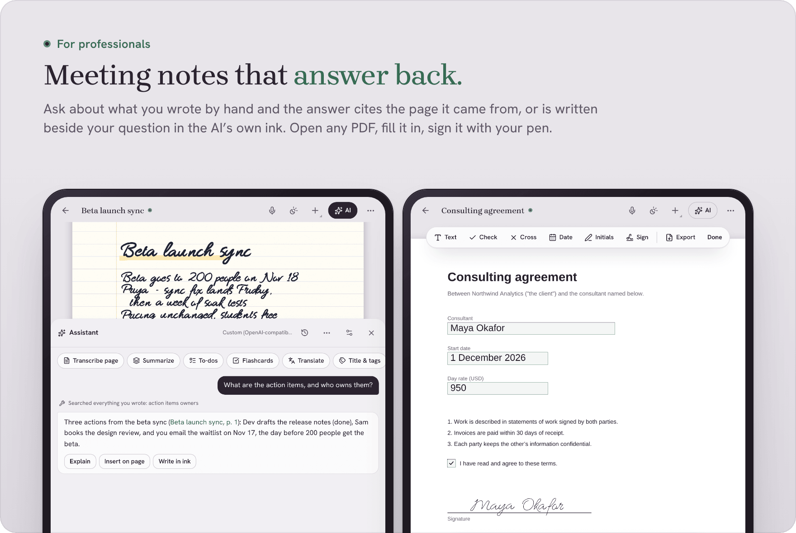
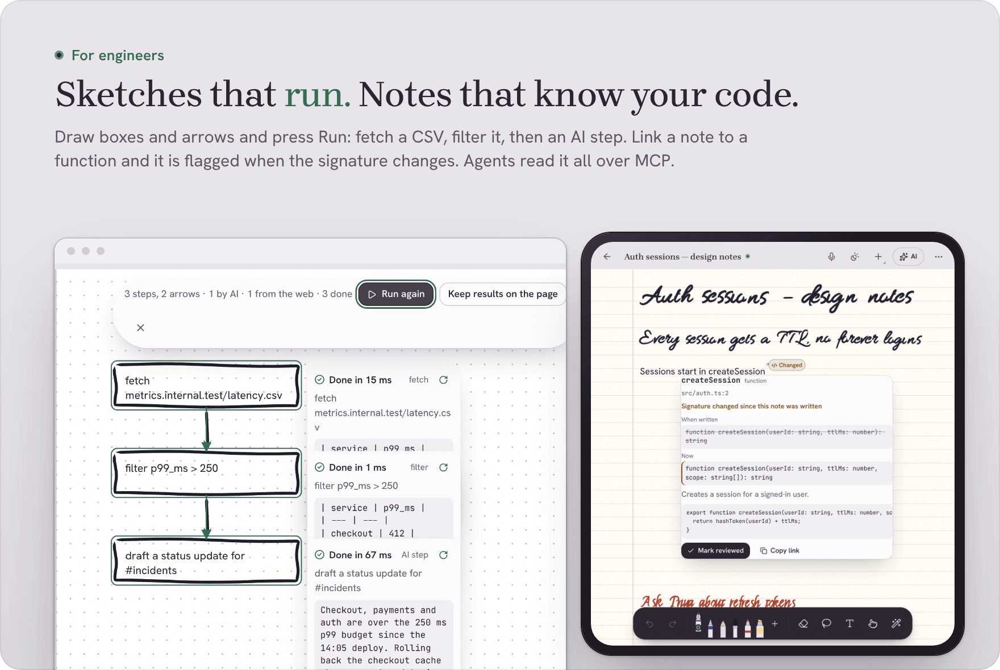
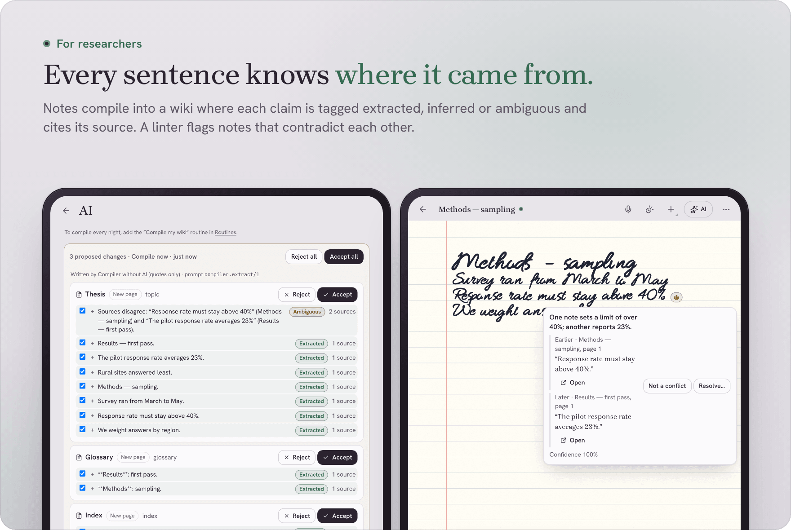
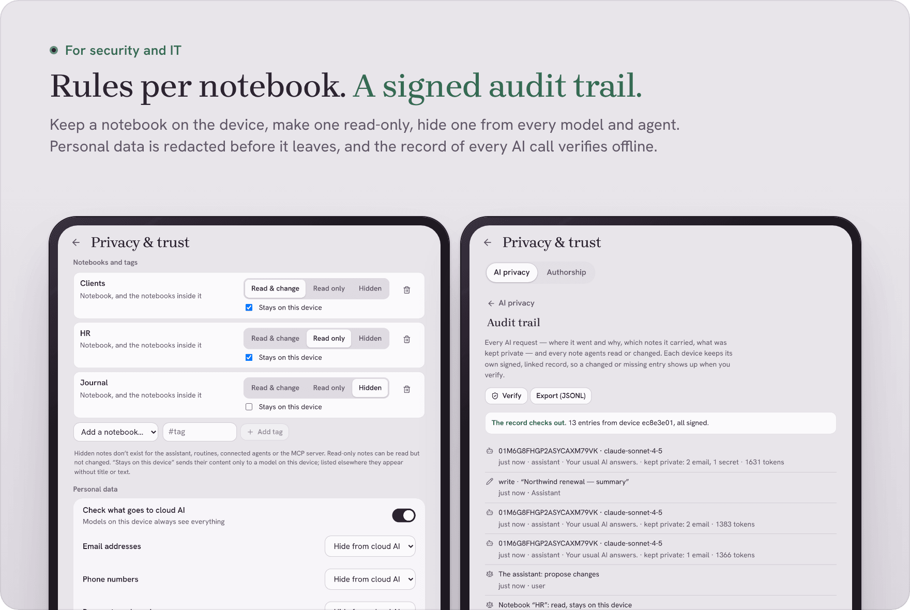
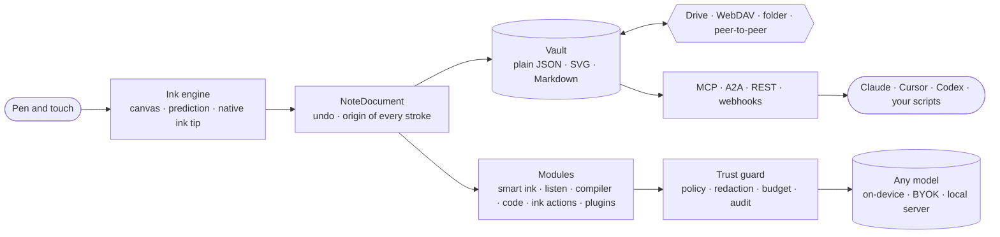

<div align="center">

<picture>
  <source media="(prefers-color-scheme: dark)" srcset="docs/media/hero-dark.svg">
  
</picture>

**A handwriting notebook that feels like paper, thinks with any AI, and answers you in ink.**<br>
Local-first. Bring your own model, or none. Open source. No server of ours, anywhere.

[Open the app](https://dev-null-k2.github.io/inkwright/app/) ·
[Android, Windows, Mac, Linux](https://github.com/dev-null-k2/inkwright/releases) ·
[For engineers](#for-software-engineers) ·
[Docs](docs/ARCHITECTURE.md) ·
[API](docs/API.md) ·
[中文](docs/i18n/README.zh-CN.md) · [日本語](docs/i18n/README.ja.md) · [Español](docs/i18n/README.es.md)

[](https://github.com/dev-null-k2/inkwright/actions/workflows/ci.yml)
[](LICENSE)


<picture><source media="(prefers-color-scheme: dark)" srcset="docs/media/showcase/hero-dark.png"></picture>

</div>

<picture><source media="(prefers-color-scheme: dark)" srcset="docs/media/section-why-dark.svg"></picture>

Paper is still the best thinking tool we have. Notes apps either feel like paper and know nothing, or know everything and feel like a form. And the AI-in-a-sidebar pattern sends your notebook to someone else's server just to answer a question about it.

Inkwright starts from the pen. Ink appears under the nib before the next frame. Scribbling a word out erases it. The nib makes a soft sound on paper and you feel the paper's grain. Then it gives that page a mind: an agent that can read your handwriting, connect it to everything else you've written, check it against itself, and write back on the page in its own visibly different ink. Your notes stay as plain files on your own devices and your own storage. Everything AI does is shown, cited, and can be undone.

It was built for a foldable phone with a stylus (Razr Fold + Moto Pen Ultra), and it works just as well on an iPad, a Windows tablet or a laptop with a mouse.

### What's new here

Handwriting apps are good at ink and closed to everything else. Knowledge tools and agent tooling are open, but you can't write in them. Inkwright puts both in one open-source app. As far as we know, nothing else does all of the following together:

| | |
|---|---|
| **Your handwriting is an API.** | The notebook is an MCP server, an A2A agent and a REST API with webhooks. Claude Code, Cursor or your own scripts can search, read and (with your approval) write in what you wrote by hand. |
| **The AI answers in ink, and shows its work.** | Answers are written on the page in a second, unmistakable ink. Every AI sentence links back to the stroke it came from, and every change can be undone. |
| **It works with no cloud at all.** | Handwriting is read on the device, maths is solved exactly on the device, and small local models (Gemma, Qwen, Gemini Nano) answer from your notes with citations. |
| **Your notes are plain files.** | The vault is documented JSON, SVG and Markdown in a folder you own, synced through your own Drive, WebDAV or devices paired with an 8-character code. |
| **Measured, not claimed.** | Every quality number in this README comes from an eval in the repository that you can re-run, including the weak ones. |


<picture><source media="(prefers-color-scheme: dark)" srcset="docs/media/section-work-dark.svg"></picture>

Every screen below is the real app, captured by a test (`apps/web/e2e/showcase.spec.ts`) with handwriting written by the app's own pen. Where an AI answers, a scripted model stands in, so the pictures show what the app does with a reply, not a particular model's wording. The terminal is a real MCP session against the same note (`scripts/brand/showcase-mcp.ts`).

### Students

<picture><source media="(prefers-color-scheme: dark)" srcset="docs/media/showcase/students-dark.png"></picture>

- **Solve what you wrote.** Lasso an equation and press Solve. It is read and solved exactly on the device, with every step, and no AI is asked.
- **Flashcards from your own pages.** Definitions and facts you wrote become cards, scheduled with FSRS, each linked to the line it came from. "Teach it back" has a tutor quiz you on a notebook and point out the gaps.
- **Lectures you can replay.** Record while you write; the transcript is made on the device and lines up with your ink, so tapping your ink plays what was said while you wrote it.

### Professionals

<picture><source media="(prefers-color-scheme: dark)" srcset="docs/media/showcase/professionals-dark.png"></picture>

- **Meeting notes that answer back.** Ask about what you wrote and the answer links to the page it came from. Lasso a question on the page and the answer is written beside it in the AI's own ink; one undo removes it.
- **Fill and sign any PDF.** Type into its fields, tick its boxes, draw your signature once and place it anywhere, then export a filled PDF.
- **Documents with a pen on top.** Headings, tables and checklists, annotated by hand, exported to Word, PDF, Markdown or HTML.

### Engineers

<picture><source media="(prefers-color-scheme: dark)" srcset="docs/media/showcase/engineers-dark.png"></picture>

- **Sketches that run.** Draw boxes and arrows and press Run. You confirm the graph it read before anything runs. Fetch, filter, sort, sum and chart need no AI; an AI step gets the upstream output as its input.
- **Notes that know your code.** `[[code:src/auth.ts#createSession]]` links a note to a function. When the signature changes the note is flagged with old and new side by side, and `inkwright drift --check` fails CI the same way.
- **Your notebook as an MCP server.** Claude Code, Cursor or Codex can search and read what you wrote by hand, and write only with your approval. More in [For software engineers](#for-software-engineers).

### Researchers

<picture><source media="(prefers-color-scheme: dark)" srcset="docs/media/showcase/researchers-dark.png"></picture>

- **A wiki that cites itself.** Notes compile into linked pages. Every sentence is tagged *extracted*, *inferred* or *ambiguous* and points to the exact spot it came from, and nothing is written until you accept it.
- **A linter for contradictions.** "Response rate must stay above 40%" in one note and "averages 23%" in another are flagged, with both sides a tap away (precision 1.00, recall 0.92 on the labelled eval below).
- **Explain this answer** separates what your notes support from what they don't, and names the model and prompt that wrote it.

### Security and IT

<picture><source media="(prefers-color-scheme: dark)" srcset="docs/media/showcase/enterprise-dark.png"></picture>

- **Rules per notebook.** Hidden, read-only, or "stays on this device", and they hold for the assistant, routines, connected agents and the MCP server alike.
- **Personal data stays home.** Emails, phone numbers and secrets are replaced before a request leaves and restored in the answer you see (precision 100 %, recall 98.2 % on the eval below).
- **Nothing silent.** Agents can be set to propose changes you approve as a diff; every AI call and every agent read or write goes into a signed audit trail that verifies offline. An air-gapped Docker appliance is available for teams ([ENTERPRISE.md](docs/ENTERPRISE.md)).


<picture><source media="(prefers-color-scheme: dark)" srcset="docs/media/section-features-dark.svg"></picture>

<table>
<tr><td width="50%" valign="top">

### ✒️ Write
- **Ink that keeps up.** Strokes are drawn from raw pen events with prediction. On Android a native ink tip draws the newest milliseconds straight to the screen.
- **Paper you can feel.** Synthesised nib-on-paper sound that follows speed and pressure. Haptic grain on Android. Three paper surfaces and nine tints.
- **Erase like paper.** Scribble over a word to delete it: it catches 99.6 % of scribbles and never erased a neighbouring word in 580 test cases. The pen button switches to the eraser.
- **Pens and tools.** Fountain, calligraphy nib, pencil, brush, highlighter, tape, sticky notes, layers, two-page spreads, snapping, locked and encrypted notes.
- **Every page you need.** Ruled, dot, Cornell, music and planner paper. Any PDF or photo of a page becomes something you can fill in and sign.
- **Documents too.** A rich-text editor (headings, tables, checklists) with the pen on top. It opens and exports Word, PDF, Markdown and HTML.

</td><td width="50%" valign="top">

### 🧠 Think
- **Any AI, or none.** OpenAI, Claude, Gemini, OpenRouter, Groq, Mistral, DeepSeek, Ollama, LM Studio or any compatible server. Or **on-device models** that use your phone's or laptop's GPU, with nothing sent anywhere.
- **Answers in ink.** Lasso a question and the answer is written beside it in handwriting, in a colour that is never mistaken for yours.
- **Smart ink.** Draw a grid to get a table. Lasso an equation to solve it with steps, read and solved on the device (no AI involved). Circle a date to make a calendar event.
- **Sketch it, run it.** Draw boxes and arrows and press Run. Each box becomes a step: fetch, filter, sum, chart, or "ask the AI".
- **Notes that listen.** Lectures are transcribed on the device. Tap any ink to hear what was said while you wrote it.

</td></tr>
<tr><td valign="top">

### 🕸️ Remember
- **A wiki that writes itself.** Your notes are compiled into linked pages. Every sentence is tagged *extracted*, *inferred* or *ambiguous* and cites the exact spot on the page it came from. **Explain this answer** shows where any AI sentence came from.
- **A linter for your thinking.** It flags notes that contradict each other, such as "latency under 50 ms" on Tuesday and "averages 110 ms" on Friday.
- **Study.** FSRS flashcards from any note or lasso. A "teach it back" tutor quizzes you and finds the gaps.
- **Links, backlinks, daily notes, a 3D graph** and two-way Obsidian import and export.
- **Search everything:** handwriting, typed text, PDFs, transcripts and meaning, on the device.

</td><td valign="top">

### 🛡️ Trust
- **Every AI call passes one checkpoint.** It routes by policy, redacts personal data (and puts it back in the answer), shortens large context so you spend about 80 % fewer tokens, and meters the cost in dollars.
- **Signed audit trail** of everything AI saw and did, which you can verify offline.
- **Per-notebook permissions:** hidden, read-only, or "never leaves this device".
- **Dry run:** agents propose changes, you approve them as a diff, and every change can be undone.
- **Proof of authorship:** a signed certificate that you wrote it by hand.
- **Air-gapped appliance** (Docker, no egress) for teams.

</td></tr>
<tr><td valign="top">

### 🧩 Make it yours
- **Every feature is a module.** Switch any of them off, or start from a preset: Student, Writer, Developer, Researcher, Enterprise, Minimal.
- **Sandboxed plugins** that ask for permission first, with a [plugin API](docs/PLUGINS.md) and a starter kit.
- **Four palettes, day and night.** Duan, Aizome, Celadon and Sumi, after the inkstones and dyes of East Asian calligraphy.

</td><td valign="top">

### 🧑‍💻 For developers
- **Notes that know your code.** `[[code:src/api.ts#createOrder]]` links a note to a function, and the note is flagged when that function's signature drifts.
- **Verified diagrams.** A typed IR and a validator mean the AI has to fix its diagram before it lands on the page.
- **Runbooks** with runnable `http`, `sql` and `js` blocks, plus an incident RCA template.
- **Data sandbox.** Drop in a CSV or Excel file and query it with DuckDB in the browser.
- **Session lessons.** Claude Code and Codex transcripts become notes, and their lessons go into `AGENTS.md`.

</td></tr>
</table>

<a id="for-software-engineers"></a>
## For software engineers

Inkwright is a notebook for the parts of engineering that happen on paper: design reviews, whiteboard sketches, incident notes, interview prep. It connects them to your code and your agents.

| You want to… | What you do |
|---|---|
| **Give your coding agent the decisions you wrote by hand** | `claude mcp add inkwright -- node apps/mcp-server/dist/index.js --vault ~/Notes --read-only`. Claude Code, Cursor or Codex can then search your notebook and cite pages. |
| **Keep design notes honest** | Link a note to code with `[[code:src/api.ts#createOrder]]`. When that function's signature changes, the note is flagged. `inkwright drift --check` fails CI the same way. |
| **Turn a whiteboard into a pipeline** | Draw boxes and arrows (fetch → filter → sum → chart) and press Run. You confirm the graph it read before anything runs. |
| **Run incidents from your notes** | Runbooks hold runnable `http`, `sql`, `js` and shell blocks. Shell blocks run only on a machine you approve, inside folders you allow, and every run goes into the audit trail. |
| **Ask about a CSV during a meeting** | Drop in a CSV or Excel file and query it with DuckDB in the browser, in plain words or SQL. |
| **Spend fewer tokens in your agents** | `inkwright-mcp proxy` is a local OpenAI/Anthropic-compatible endpoint that shortens large tool output reversibly and meters the savings ([PROXY.md](docs/PROXY.md)). |
| **Keep keys out of your agents** | The credential executor holds provider keys in a separate process, checks each call against policy and never hands a key out ([CREDENTIALS.md](docs/CREDENTIALS.md)). |
| **Work under an NDA** | Mark notebooks "never leaves this device", run models locally, or deploy the air-gapped Docker appliance ([ENTERPRISE.md](docs/ENTERPRISE.md)). |
| **Learn from your agent sessions** | Import Claude Code and Codex transcripts; their lessons are written into `AGENTS.md`. |

**Worth reading in the code**, if you're here for the engineering:

- **Stroke-level three-way merge** (`packages/sync`): two devices edit the same page offline and both sets of strokes survive. Documents merge paragraph by paragraph.
- **Pairing with an 8-character code** (`packages/sync/src/peer/cpace.ts`): CPace, a password-authenticated key exchange on ristretto255, so a short code is safe to read aloud. A wrong guess costs one of five tries.
- **Handwritten maths** (`packages/core/src/mathink`): symbols grouped from raw strokes, a 2D layout parser for fractions, powers and roots, and an exact solver that shows its steps ([MATH.md](docs/MATH.md)).
- **Tool calls on small models** (`packages/ai`): one parser for every format local models emit (Gemma, Qwen, Llama, Mistral, JSON, Python-style), argument repair, and retrieval before generation so a 0.6B model can answer from your notes ([LOCAL_AI.md](docs/LOCAL_AI.md)).
- **One checkpoint for every AI call** (`packages/ai/src/trust`): policy routing, reversible PII redaction, context budgeting, cost metering and a signed audit trail ([TRUST.md](docs/TRUST.md)).
- **An open context format** (`spec/personal-context/v1.md`): context packs with a JSON Schema and a conformance suite, so other tools can produce and read them.
- **Engineering hygiene**: TypeScript strict across a monorepo, actions pinned by SHA, an independent security review with its fixes ([SECURITY_REVIEW.md](docs/SECURITY_REVIEW.md)), and a startup budget that fails CI on regressions.

<picture><source media="(prefers-color-scheme: dark)" srcset="docs/media/section-agents-dark.svg"></picture>

Your notebook is also a server that your other tools can talk to. It speaks the protocols agents already use:

| | |
|---|---|
| **MCP** (spec 2026-07-28) | stdio and Streamable HTTP; OAuth resource server; Tasks; MCP Apps; context packs as resources ([AGENTS.md](docs/AGENTS.md)) |
| **A2A** | an agent card and skills, so other agents can delegate to your notebook |
| **REST** | `/api/v1` with OpenAPI 3.1, scoped API keys, ETags, idempotency keys, rate limits ([API.md](docs/API.md)) |
| **Webhooks** | Standard Webhooks: signed and retried. `note.created`, `recording.ended`, `routine.finished`… |
| **SDK** | `@inkwright/sdk`, generated from the OpenAPI document |
| **CLI and skill** | `inkwright scan <repo>`, `inkwright drift --check` for CI, and an Agent Skill for Claude Code and Codex |
| **Links** | `inkwright://new`, `capture`, `search`, `today` for Shortcuts, Tasker and launchers |

```sh
# Give Claude Code your notebook (read-only shown; drop --read-only to let it write, with approvals)
claude mcp add --scope user inkwright -- node ./apps/mcp-server/dist/index.js --vault ~/Notes --read-only

# Or call the REST API like any other service
curl -H "Authorization: Bearer $INKWRIGHT_KEY" "http://127.0.0.1:8765/api/v1/search?q=latency&mode=hybrid"
```

## Measured, not claimed

Every number below comes from an eval or test in this repository and can be re-run with one command ([TESTING.md](docs/TESTING.md)). Where a number is weak, it is still listed.

| What | Result | How |
|---|---|---|
| Scribble-to-erase | 99.6 % of 250 scribbles caught; 0 of 330 normal strokes erased | `packages/core/evals/scratch.eval.ts` |
| Scribble-to-erase on real letter shapes (large, slanted, cursive; zig-zags, loops, strike-throughs) | 98.3 % of 300 crossed-out words fully erased; 0 neighbours touched; 0 of 200 next words or underlines erased (was 77.7 %, found after testing on a phone) | `packages/core/evals/scratch-real.eval.ts` |
| Contradiction linter | precision 1.00, recall 0.92 on 58 labelled pairs; 0 false alarms in 40 everyday notes | `packages/core/evals/compiler.eval.ts` |
| Wiki drafts vs a noisy model | provenance precision 0.92; unsupported sentences let through 0.17 | `packages/ai/evals/compiler.eval.ts` |
| Personal-data firewall | precision 100 %, recall 98.2 % (78 labelled lines; names without context are missed) | `packages/ai/evals/trust.eval.ts` |
| Context budgeter | 80 % of tokens saved across tasks; answers unchanged. "Summarise everything" costs 47 % *more* | same |
| Prompt-injection detector | **weak on held-out attacks: 29 % detected, 17 % false alarms.** What holds regardless: deletes always ask, dry run and strict mode block writes, local-only notes never reach the cloud | same |
| Sketch → graph extraction | 1.0 on 120 synthetic sketches (real sketches will do worse; you confirm the graph before it runs) | `packages/core/evals/canvasdag.eval.ts` |
| Photo → ink | traced strokes within one pen width of the source for tilted, blurred and noisy photos | `packages/core/test/photoink.test.ts` |
| Handwritten maths | 94.0 % of 350 synthetic handwritten problems solved exactly with ML Kit's symbol reader (77.7 % with the built-in web reader; was 18.3 %). Synthetic strokes: real handwriting will differ | `apps/web/evals/mathink.eval.ts`, [MATH.md](docs/MATH.md) |
| On-device models answering from notes | Qwen3 0.6B: 11 of 11 grounding, tool-call and "not in your notes" cases (was 4 of 11); Qwen3 1.7B: 11 of 11. Run on a CPU with the app's own engine; Gemma and Gemini Nano are not covered by this eval | `npm run eval:local`, [LOCAL_AI.md](docs/LOCAL_AI.md) |
| Size and startup | Play download for an arm64 phone 20.7 MB (was 49.9 MB); library interactive in 1.1 s at 4× CPU slowdown (was 1.9 s), 3.4 s adding a mid-tier mobile network (was 8.2 s); a startup budget fails CI on regressions | `npm run perf:budget -w @inkwright/web`, [PERFORMANCE.md](docs/PERFORMANCE.md) |
| Tests | 1,800+ unit tests and evals, 240+ end-to-end tests (Chromium, plus WebKit and Firefox at phone, foldable and desktop sizes), 158 Android JVM tests, zero serious accessibility violations (axe); a test clicks every button at the Razr Fold's screen size | `npm test`, `npm run e2e:all` |

<picture><source media="(prefers-color-scheme: dark)" srcset="docs/media/section-start-dark.svg"></picture>

- **In a browser:** [open the app](https://dev-null-k2.github.io/inkwright/app/). It installs as an offline app on Mac, Windows, Linux, ChromeOS and iPad. Your notes stay in the browser until you connect Google Drive, WebDAV or a folder.
- **iPhone and iPad:** [open the app](https://dev-null-k2.github.io/inkwright/app/) in Safari, then Share › **Add to Home Screen**. It runs offline and Apple Pencil writes with pressure and tilt. The native iOS app (Pencil double-tap and squeeze, Apple's on-device model, notes in the Files app) is built and tested on every change and is on its way to TestFlight ([IOS.md](docs/IOS.md)).
- **Android:** download `Inkwright-<version>-arm64-v8a.apk` from [Releases](https://github.com/dev-null-k2/inkwright/releases) (`armeabi-v7a` for older 32-bit phones). Install it once: after that the app updates itself from inside the app whenever a new release is published ([UPDATES.md](docs/UPDATES.md)). Google Play is coming.
- **Sync with Google Drive:** in the web app or on Android, open Settings › Sync & devices › **Sign in with Google** and pick your account. Notes go to an *Inkwright* folder in your own Drive; the app can't see anything else there. Or pair two devices with an 8-character code, or use WebDAV or a folder.
- **Windows, Mac, Linux:** the desktop app (`.exe`, `.dmg`, `.deb`, `.AppImage`) is on the same [Releases](https://github.com/dev-null-k2/inkwright/releases) page. It adds a memory timeline of what you worked on and a journal that writes itself ([DESKTOP.md](docs/DESKTOP.md)). Beta builds are not code-signed yet, so the first launch asks you to confirm.
- **From source:**

```sh
git clone https://github.com/dev-null-k2/inkwright && cd inkwright
npm install
npm run dev        # http://localhost:5173
npm test           # unit tests and evals
npm run e2e        # end-to-end, Chromium (npm run e2e:all for WebKit and Firefox too)
```

Android: [docs/ANDROID.md](docs/ANDROID.md). Enterprise appliance: [docs/ENTERPRISE.md](docs/ENTERPRISE.md). Hosting it yourself (static files, no backend): [docs/HOSTING.md](docs/HOSTING.md).

<picture><source media="(prefers-color-scheme: dark)" srcset="docs/media/section-under-dark.svg"></picture>



| Package | What's in it |
|---|---|
| `packages/core` | data model, vault format, gestures, shapes, handwriting synthesis, search, compiler, code graph, exporters. No platform code. |
| `packages/ai` | providers, the agent loop, tools, skills, memory, routines, MCP client, the trust guard, evals |
| `packages/sync` | storage backends and the three-way, stroke-level merge |
| `packages/plugin-api`, `packages/sdk` | plugin protocol and types; the REST client |
| `apps/web` | the app (React + a canvas ink engine), a PWA, Capacitor for Android and iOS |
| `apps/mcp-server` | MCP, A2A, REST, webhooks, the always-on agent runner and the CLI |

The vault is documented field by field in [VAULT_FORMAT.md](docs/VAULT_FORMAT.md). If Inkwright disappeared tomorrow, your notes would still be readable files.

<picture><source media="(prefers-color-scheme: dark)" srcset="docs/media/section-roadmap-dark.svg"></picture>

See [ROADMAP.md](ROADMAP.md). Next up: Google Play, the iOS App Store build, signed desktop installers, live collaboration out of beta, a smaller first download (the local-model engine fetched only when you turn it on), and real-device evals for pen latency, handwriting and on-device models on as many phones and styluses as people will lend us.

<picture><source media="(prefers-color-scheme: dark)" srcset="docs/media/section-story-dark.svg"></picture>

An *inkwright* is someone who makes ink. The name fits a tool that makes ink do more: it turns strokes into meaning, and meaning back into strokes. The headings in this README were written by the app's own pen (`packages/core/src/handwrite.ts`, using single-line fonts under the OFL) and replay in the timing the synthesiser produced. Run `npm run art` to regenerate them.

Inkwright is built by [Karthik Kasukurti](https://github.com/dev-null-k2). Contributions are welcome. Start with [CONTRIBUTING.md](CONTRIBUTING.md). Security reports go through [SECURITY.md](SECURITY.md).

Licensed under [Apache-2.0](LICENSE). Fonts and third-party notices are listed in [NOTICE](NOTICE).
